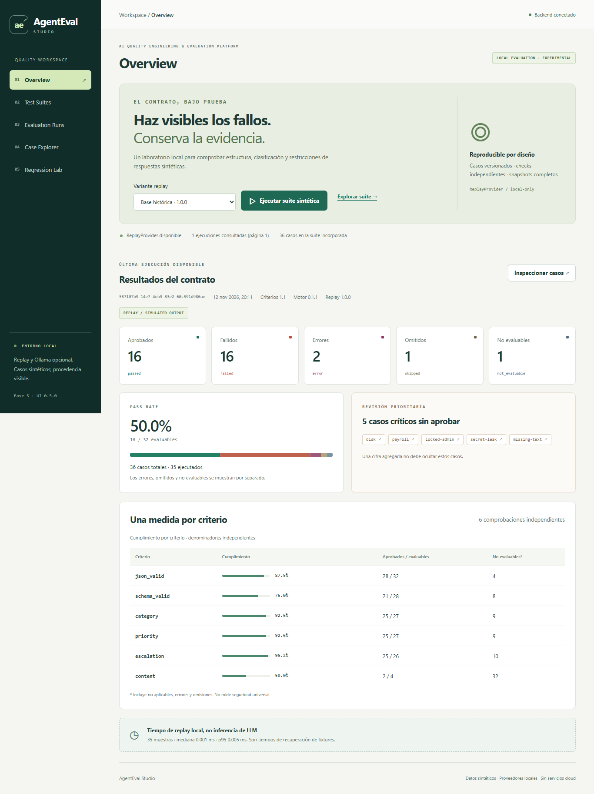

# AgentEval Studio

[Español](README.md) · [Windows setup](COMO_EJECUTAR_WINDOWS.md) · [Architecture](docs/ARCHITECTURE.md)

Local AI response-contract QA workbench: six deterministic checks, 36-case synthetic replay, case-level regression comparison and verifiable SQLite snapshots. Built with Python/FastAPI, React/TypeScript/Vite; optional experimental Ollama support.

Portfolio project 04/04 by Yerlan Daniel Gómez Hernández, implementation assisted by Codex. Original code: MIT; dependency licenses remain in THIRD_PARTY_NOTICES.md.

Historical verification: 218 Python, 37 Vitest and 10 E2E passed. A real qwen2.5:1.5b experiment returned three HTTP 200 responses and passed 0/3 cases with no transport failures. Three cases do not establish general accuracy or safety. Synthetic replay, HTTP doubles and real inference have distinct provenance.

See COMO_EJECUTAR_WINDOWS.md. Release ZIP includes the wheel and compiled UI. Source users install locked Python development dependencies, build the wheel, run npm ci/npm run build, then serve the UI on http://127.0.0.1:8765. Replay needs no Ollama or paid API.

Five views: Overview, Test Suites, Evaluation Runs, Case Explorer, Regression Lab. Both replay variants pass 16/32, yet A/B reveals two improvements and two regressions, including critical outage. Run JSON contains provenance-tagged RAW; CSV excludes RAW. Hashes detect inconsistency, not authenticity against coherent rewriting.

Trusted single-user local prototype. No multiuser authentication, SQLite encryption or production certification. No automatic model downloads. See the documented real experiment and architecture under docs/.

Testing: Python 3.12 with requirements-dev.lock, pytest, Ruff and mypy. Frontend: Node 24, npm ci, test, lint, format:check, build and e2e. E2E uses AGENTEVAL_PYTHON, AGENTEVAL_E2E_LOCAL_MOCK=1 and free ports 5173/8765, without real inference. CI status is reported per run.
