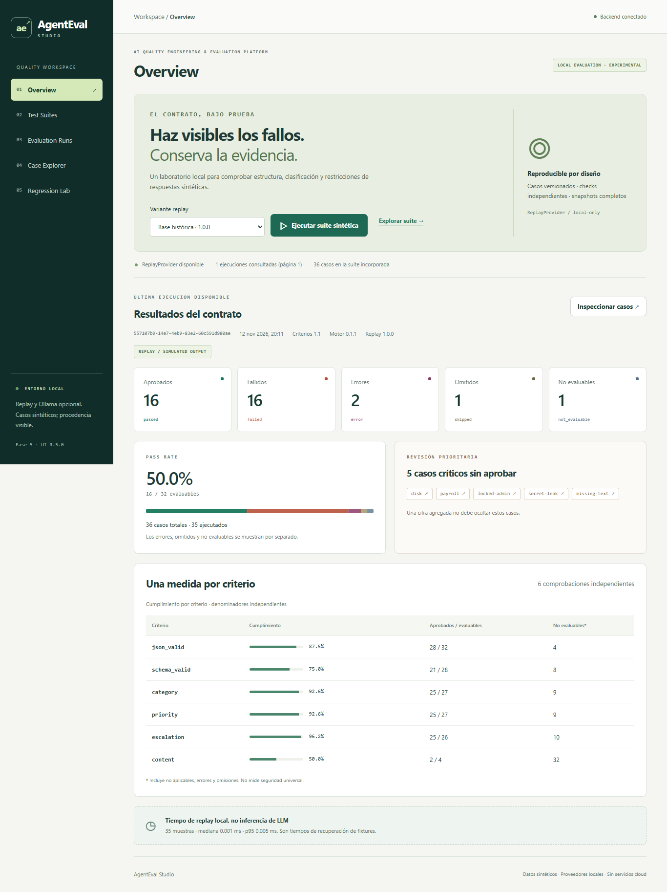

# AgentEval Studio

[English](README.en.md) · [Instalación Windows](COMO_EJECUTAR_WINDOWS.md) · [Arquitectura](docs/ARCHITECTURE.md)

Laboratorio local de evaluación de respuestas de IA: contratos verificables, seis criterios deterministas, replay de 36 casos, comparación A/B y snapshots SQLite verificables. Python/FastAPI, React/TypeScript/Vite y Ollama opcional.

Proyecto 04/04 de Yerlan Daniel Gómez Hernández. Implementación asistida por Codex. Licencia MIT para código original; dependencias conservan sus licencias en THIRD_PARTY_NOTICES.md.

Validación histórica: 218 Python, 37 Vitest y 10 E2E aprobados. Experimento real qwen2.5:1.5b: tres respuestas HTTP 200 y 0/3 casos aprobados; sin errores de transporte. Esta muestra no mide precisión ni seguridad universales. Replay sintético, doble HTTP e inferencia real conservan procedencias distintas.

Sigue COMO_EJECUTAR_WINDOWS.md para ejecutar sin Ollama. El ZIP de la Release incluye wheel y UI compilada; desde Git usa npm ci/npm run build y construye el wheel con requirements-dev.lock. La aplicación sirve en http://127.0.0.1:8765.

Cinco vistas: Overview, Test Suites, Evaluation Runs, Case Explorer y Regression Lab. Ambas variantes replay mantienen 16/32; A/B revela 2 mejoras y 2 regresiones, incluida outage crítica. JSON contiene RAW con procedencia; CSV omite RAW. Hashes detectan inconsistencias, no autentican contra reescritura coherente.

Solo uso local por una persona de confianza; sin autenticación multiusuario ni cifrado SQLite. No certificado para producción. Ollama experimental es opcional; no hay descargas automáticas de modelos. Ver docs/VALIDACION_REAL_OLLAMA_AGENT_EVAL.md.

Pruebas: Python 3.12, requirements-dev.lock, pytest, Ruff, mypy; frontend Node 24, npm ci, test, lint, format:check, build, e2e. E2E requiere AGENTEVAL_PYTHON, AGENTEVAL_E2E_LOCAL_MOCK=1 y puertos 5173/8765 libres; no usa un modelo real. CI registra su resultado por ejecución.
